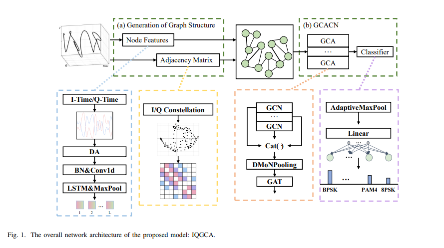
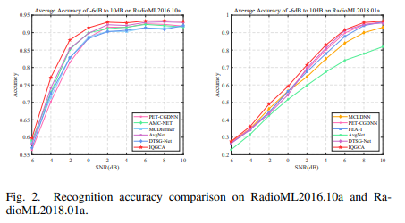
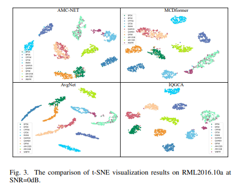

# Modulation Identification

I. Title: IQGCA: A Lightweight I/Q Signal Graph Structure for Autonomous Modulation Recognition
II. Abstract: Autonomous Modulation Recognition (AMR) is a key technology in the Internet of Vehicles (IoV), facilitating efficient communication. However, the contradiction between computational complexity and high recognition efficiency limits the application of AMR. To reduce computational costs and achieve high recognition accuracy, researchers have proposed an approach called I/Q Signal Graph coarsening attention network (IQGCA). In this method, by mapping 3D I/Q signals to different planes to generate a graph structure, time correlation and spatial distribution are learned. On this basis, a graph coarsening attention (GCA) block is introduced, which can coarsen the graph structure and extract features with minimal computational cost.
Experimental results on datasets RadioML2016.10a and RadioML2018.01a with different sample lengths demonstrate that the proposed IQGCA outperforms the current state-of-the-art (SOTA) methods in terms of recognition accuracy and lightweight model design.
III. Introduction: In recent years, the Internet of Vehicles (IoV) has become an important component of intelligent transportation systems (ITS). However, the increasingly congested wireless spectrum resources pose severe challenges, leading to significant interference in IoV communication. Autonomous Modulation Recognition (AMR) is a key technology in intelligent radios, capable of optimizing spectrum resource allocation through the recognition of modulation types, thereby enhancing the efficiency and reliability of IoV communication.
In recent years, deep learning-based automatic modulation recognition (DL-AMR) has become a popular research direction due to its superior classification capabilities compared to traditional methods. For example, Zhang et al. have combined Convolutional Neural Networks (CNN) and Long Short-Term Memory Networks (LSTM) to explore the interaction of signal features and spatiotemporal (ST) characteristics to enhance recognition efficiency; Xu et al. proposed a Multi-Channel Convolutional Long Short-Term Deep Neural Network (MCLDNN) framework to improve convergence speed and attempted to combine CNN with Gated Recurrent Units (GRUs) as feature extraction layers to further enhance robustness in feature extraction; to address challenges from low Signal-to-Noise Ratio (SNR) environments, Zhang et al. introduced a new method that combines frequency domain denoising with multi-scale feature analysis. With the popularity of the Transformer architecture, research teams have also proposed models based on this framework, such as Frame Embedding Aided Transformer (FEA-T) and Multi-Channel Convolution Distillation Transformer (MCDformer), which further improved recognition accuracy.
To better capture the spatiotemporal characteristics of signals, researchers have also explored the use of graph neural networks (GNNs), which demonstrate strong performance in time series analysis. For example, Xuan et al. proposed the AvgNet method, which constructs an adjacency matrix using CNN and generates two types of graph structures from both coherent and orthogonal signal components; Ghasemzadeh et al. transformed the signal constellation graph into a graph structure and input it to the feature extraction stage, subsequently proposing the Gated Graph Convolutional Neural Network (GGCNN), which is equally effective for higher-order modulation types; Yin et al. introduced the Dynamic Time Series Graph (DTSG) algorithm, which was combined with Recurrent Neural Networks (RNNs), achieving progress in long sequence signal modulation recognition; In 2025, Zhang et al. proposed the AMR method based on the Adaptive Relational Graph Attention Network (ARGAT), which retains the temporal characteristics of signals and adaptively assigns edge weights in the graph, thereby improving recognition performance under low SNR conditions; Ke et al. introduced the Graph-based Graph Neural Network (GIGNet), which uses multi-level graph neural networks to extract graph-based internal features from signal samples as well as relevant information between different signals represented by nodes in the graph. These studies indicate that converting signals into graph structures is an effective way of feature extraction.
Despite the promising development prospects of AMR based on GNNs for integrating into vehicle-to-everything communication, there are still challenges. On one hand, there is a lack of simple and efficient methods for generating signal graph structures; on the other hand, the complexity of subsequent processing of signal graph structures is too high. To achieve smaller model sizes for application in vehicle-to-everything communication, Wang et al. introduced a scaling factor for CNNs, while Zhang et al. proposed an AMC method based on progressively scalable architecture search, but these models did not meet expectations in terms of performance. Moreover, according to researchers, although existing research has demonstrated the potential of AMR based on GNNs, its lightweight design has not yet been explored.
In response to the lack of efficient graph construction methods and high computational complexity in existing GNN-based AMR approaches, researchers have proposed a lightweight method —— I/Q Signal Graph Granularized Attention Network (IQGCA). This method leverages mapping to acquire prior knowledge of signal modulation for generating graph structures. While significantly reducing the number of trainable parameters and floating-point operations (FLOPs), it maintains the model's representational power and recognition performance. Specifically, mapping 3D I/Q signals to I-time and Q-time planes enables learning temporal correlation as node features in the graph, while mapping to the I-Q plane captures spatial distribution as an adjacency matrix. Furthermore, by introducing Graph Granularization Attention (GCA) blocks, each containing GNNs, Deep Modular Network Pooling (DMoNPooling), and Graph Attention (GAT), this block efficiently achieves graph structure message passing and granularization with reduced computational cost.
The main contributions of this study are as follows:
1  
To simplify the signal graph structure and enhance efficiency, it is proposed to map 3D I/Q signals onto different planes for processing to construct node features and adjacency matrices.
2  
To ensure the effectiveness of feature extraction under lightweight conditions, a GCA block is designed to combine the advantages of graph convolutional networks (GCN), DMoNPooling, and GAT for coarsening and feature extraction.
3  
Experimental results on datasets with different sample lengths show that the proposed method outperforms the current state-of-the-art DL-AMR method in terms of computational complexity.
IV. IQGCA Network Model Architecture
(I) The overall modulation recognition process receives 3D I/Q signals, which are first mapped onto the I-time and Q-time planes to obtain a time series. This time series is then processed through data augmentation (DA) and feature learning to generate node features. Subsequently, an adjacency matrix is obtained from the mapping of the I/Q constellation diagram, where the I/Q constellation diagram represents the projection of the 3D I/Q signal on the I-Q plane. Finally, the graph structure is input into a graph classification network composed of GCA blocks and classifiers for processing.
(II) Graph Node Feature Generation 1
Signal Mapping: After the received 3D I/Q signals are mapped to the I-time and Q-time planes, they can be represented as a two-dimensional sequence \( r_{IQ} \) in \(\mathbb{R}^{2 \times L}\), expressed as:
Among them, the I component and Q component correspond to the time series of I and Q components respectively, and L is the length of signal samples.
1  
Data Augmentation (DA): To enhance the generalization and robustness of the model during training, rotation operations are applied to the received I/Q signals as data augmentation. The rotation angle θ is randomly selected from the set [0°, 90°, 180°, 270°], which can simulate phase changes commonly encountered in wireless communication environments (such as phase shifts caused by channel effects or synchronization offsets), allowing the model to learn a broader signal representation distribution. The rotation operation is expressed as:
Among them, the signal after data augmentation is indicated.
1  
Feature Processing: Before entering the network, node features need to integrate information from adjacent nodes. To achieve this, CNN and LSTM are used for further processing. Firstly, batch normalization and one-dimensional convolution operations are performed to extract local spatial features, expressed as:
Next, LSTM is used to capture the temporal dependencies in the data and downsampled by max pooling layer (MaxPooling) to reduce the spatial dimension of node features. The expression is:
Among them, X'={x1', x2',..., xN'} ∈ R^N×d represents the node features of the graph structure. N is the number of nodes, and d is the dimension of each node feature. In this process, the number of signal sampling points remains unchanged to ensure that the constellation diagram can be directly used for generating an adjacency matrix, thus N equals L.
1  
Diagonal feature calculation: The mth diagonal of the adjacency matrix represents the edge characteristic between point i and point (i+m). The expression for calculating the mth diagonal feature is:
Among them, Same (・) is used to judge whether the star point is in the same quarter.
1  
Adjacency Matrix Construction: Embedded in H, the expression is:
Among them, the embed (・) function represents that the embedded into H, n is the upper limit of correlation. Considering that the connection will weaken when signal points are far away, setting to make use of correlation and keep the sparsity of the adjacent matrix.
(IV) The Gradient Convolution Attention Classification Network (GCACN) introduces GCA blocks to coarsen the graph, extracting features from the constructed I/Q graph structure. This block is inspired by GCN, DMoNPooling, and GAT.
1  
GCN layer processing: In the GCA block, the graph structure first undergoes G layer GCN processing. The node feature transmission mechanism expression of each GCN layer is as follows:
Among them, K is the number of GCA blocks; represents the angle matrix used as a normalizer, and; denotes the adjacency matrix after inserting the self-loop I. W is the trainable parameters.
1  
The operation of DMoNPooling is to concatenate the results of each layer of GCN, which is denoted as Z, and then input it into DMoNPooling for concatenation operation. DMoNPooling can capture and aggregate information from multiple neighborhoods at different orders, retaining important structural and semantic information during graph coarsening. It dynamically clusters nodes based on feature similarity and graph topology. The operation mechanism of DMoNPooling is expressed as:
where S represents dense learning assignment; \hat{x}{k} ∈ {R}^{N_{k+1} ×F}; H{k+1} ∈ {R}^{N_{k+1} ×N_{k+1}}; F is the feature dimension of each node after coarsening; n is the number of nodes in the kth block, C is the coarsening factor of GCA.
1
Introducing GAT mechanism: Adding the GAT mechanism allows the model to adaptively and learnably weight adjacent nodes during message passing, thus focusing on more relevant features. The feature expression of the i-th node after attention mechanism is:
where  represents the corresponding attention parameters;  represents the set of nodes directly related to the i-th node.
1
Classification process: After K blocks of GCA, the graph structure is downsampled through pooling operations, and the obtained feature vectors are classified through a linear layer to obtain the probability distribution p. Then, the index of the modulation type with the highest probability distribution is taken as the final classification result.
V. Conclusion Researchers have proposed the IQGCA method, which is a lightweight method with high performance. By mapping 3D I/Q signals to different planes, this method extracts time correlation and spatial distribution information, simplifying the generation operation of graph structure. In addition, GCA blocks help signal graph structure coarsening and efficient feature extraction. Various experiments have verified the effectiveness of this method, and its performance indicators also reflect its advantages.
This method generates signal graph structures by integrating spatiotemporal domain information. Future research directions include exploring how to incorporate more signal domains to further enhance the feature representation in these graph structures, designing recognition systems suitable for variable-length signals, and addressing more complex communication scenarios, thereby promoting the application of graph neural networks in actual Internet of Things communication systems.
End

## Images

<!-- PAYMENT_BLOCK -->

## Get this dataset

- Payment link (Stripe): [Buy now](https://buy.stripe.com/3cs8yP7sY87d0vu9AB)
- Payment QR code: 

<!-- /PAYMENT_BLOCK -->
